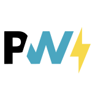

<picture>
  <source media="(prefers-color-scheme: dark)" srcset="https://github.com/vite-pwa/.github/raw/main/hero-dark.svg" />
  
</picture>

<h1 align="center">
Vite PWA
</h1>

PWA Ecosystem

  <a href="https://unplugin-pwa.netlify.app/">Documentation</a> —
  <a href="https://unplugin-pwa.netlify.app/guide/">Getting Started</a>

<h3 align="center">
<a href="https://discord.com/invite/uccDuWkScq"><i>Get involved!</i></a>
</h3>
